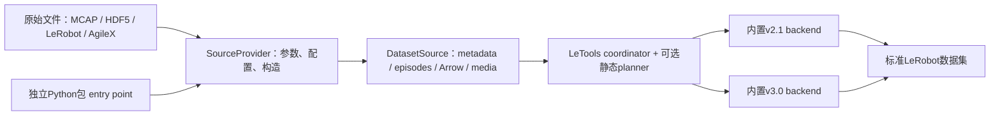
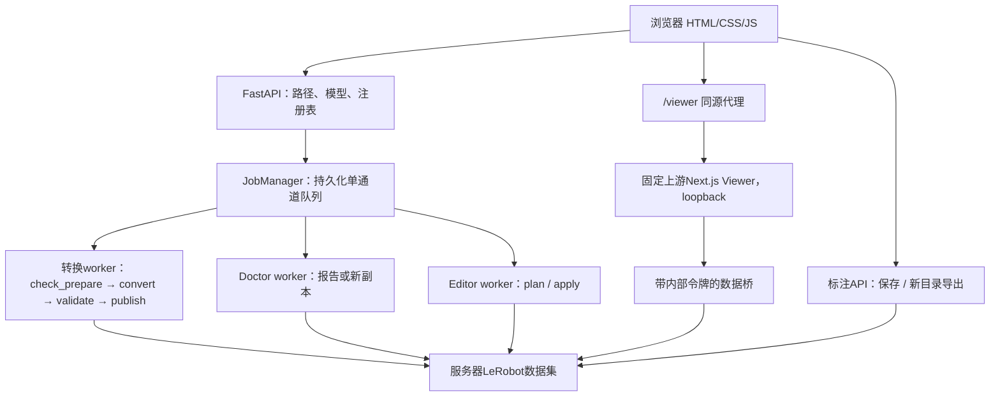

# 架构与代码导航

平台0.5.0，最后核验2026-10-15。本仓库是一层Web编排，不承担机器人控制或训练，也不将转换对齐算法复制到HTTP路由里。原始 MCAP 查看使用独立只读适配层，不执行 provider 的转换预处理，模块和缓存契约见[原始查看器](raw-viewer.md)。

## 三个独立项目与两层“前后端”

| 项目 | 职责 | 典型扩展点 |
|---|---|---|
| [letools](https://github.com/XieWeikai/letools) | 统一数据模型、转换/规划、v2.1/v3.0后端、验证/比较/merge、工具集成 | DatasetSource、SourceProvider、内置backend、native粗粒度算子 |
| [data-providers](https://github.com/XieWeikai/data-providers) | 独立打包的输入适配器；Tianji读取MCAP、检查、对齐、准备 | Python entry point，不修改LeTools核心 |
| [letools-data-platform](https://github.com/XieWeikai/letools-data-platform) | 页面、路径选择、队列、进度、登记、Viewer/Doctor/Editor适配 | 参数模型、请求验证、worker、同源路由 |

LeTools的**数据前端**是输入适配器，**数据后端**是目标格式写入器。这与浏览器前端/FastAPI服务器是两个不同层次。



`SourceProvider`负责名字、别名、CLI参数、不可变配置和`open()`；`DatasetSource`负责读取，暴露`DatasetMetadata`、稳定顺序的`Episode`、`pyarrow.Table`及媒体。`VideoSlice`引用已编码片段，`FrameSequence`提供分批图像。后端不需要知道MCAP topic或原机器人时间戳如何解析；provider也不用实现两套LeRobot文件布局。

插件安装到同一个Python环境，通过`letools.source_providers` entry point发现。输出后端目前内置；这个entry point不注册第三方writer。Provider被CLI发现后，仍需为Web实现选择/参数/worker适配，不能仅安装任意插件就声称网页全部支持。当前Tianji仅本地执行，拒绝分布式构造。

## Web请求与进程



API进程不在请求线程里长时间编码。它先规范化路径和参数，持久化`request.json`，再由唯一队列线程以argv列表启动独立Python模块。所有转换、Doctor、Editor共用队列；每个worker拥有独立进程组。取消/关闭先结束整组，再回收PID，避免误杀重用的PID。

客户端轮询JSON状态；worker通过标准输出的`DWP_EVENT` JSON行报告真实阶段、检查结果、验证与最终结果。普通日志按文本保存，网页用textContent显示。阶段完成不等于任务完成：最终结果、退出码和必要的输出校验共同决定终态。

服务重启不会自动重放旧请求。任何未完成状态会标记`interrupted`，保留日志，交给操作者核对后重新提交。输出路径在队列中预留以减少竞争，最终发布仍需要独立的防覆盖检查。

0.4.0任务清除只在`.state/hidden-jobs.json`原子记录隐藏ID，保留记录/报告/缓存和已有Editor计划引用；活动任务整批拒绝。取消登记则在注册锁内原子重写datasets.json，不读写数据集文件。两种清理互相独立，都不属于数据删除。

目录补全只查直接子目录或匹配最后一段前缀，遵守允许根与符号链接边界；前端防抖并按请求序号拒绝旧响应。新建是单层排他mkdir，不覆盖，不创建最终目标或修改已有录制/数据集内容。`ui_help.py`集中维护参数说明，`help.js`支持hover/focus/tap；`explanations.py`只补充解释而不改诊断级别，使用textContent显示输入与日志。

## 严格转换的分工

1. API确认provider确实在配置的解释器中可用、选择来自当前原始目录、目标尚不存在且不与输入嵌套。
2. worker确认录制已保存，建立仅包含所选轨迹的目录链接，创建唯一TianjiConfig。
3. provider的`check_and_prepare(..., prepare_valid_only=True)`共享读取和视频帧流，检查全部输入，只给通过项生成缓存并重编号。平台核对逐条诊断、原录制到episode映射和帧数；异常清单完整保留。全部异常不产生成功清单；运行故障直接终止。
4. LeTools读取缓存，向私有暂存目标写出指定布局；已准备H.264不二次有损编码。
5. worker对暂存结果做deep validation，随后通过Linux防覆盖原子rename发布。目标竞争、验证或源稳定性失败均不覆盖已有数据。

独立“仅检查”仍调用check_dataset，不写缓存，发现异常仍返回失败诊断。普通provider CLI的check和prepare仍是两次调用；融合只是显式优化入口，不是隐式全局缓存。Web转换固定使用valid-only，客户端不能传任意策略覆盖。`conversion_summary.py`负责输入metadata时长、通过/跳过分组及映射核验；已发布输出数量和时长来自验证后的info.json。摘要事件持久化到任务并随JSON报告返回。

并发有不同层次：队列一次一个作业；Tianji当前自动最多12个录制worker；网页的data/video workers属于后续LeTools封装；Editor有自己的文件/codec并发。把它们混成一个“线程数”会误导调参。当前硬件加速仅编码；CUVID解码因损坏数据拒绝不等价未采用。

## Viewer、Annotation和副本操作

Viewer上游由LeTools固定提交，平台仅在`.state`生成副本里应用`viewer_overlay`。浏览器读取同源地址；Next.js服务端读取用loopback桥及内部令牌，令牌不进入浏览器bundle。视频Range请求只做必要的新鲜元数据/路径检查，不重新扫描每个Parquet。

| 操作 | 写入策略 | 完成边界 |
|---|---|---|
| 原始转换 / Editor apply | 独占暂存目录 | 校验/源稳定后原子防覆盖发布 |
| Doctor fix / trim | 独占新副本/新目标，带`.dwp-incomplete` | 上游操作、deep validation、源稳定后去掉标记；失败副本不可登记 |
| Annotation save | 当前数据集`meta/lerobot_annotations.json` | 文件锁、固定路径/目录fd、原子替换；不重写视频/表格 |
| Annotation export | 新暂存输出，物化语言列，视频复制/硬链接 | 防覆盖发布；不能把它说成转换worker的同一deep-validation流程 |
| Registry register | `.state/datasets.json`中的引用与元数据 | 检查物理布局；不搬移、不上传、不等于训练质量通过 |

Doctor的`observation.action`兼容视图为上游actions、per_episode、training、kinematics检查及score/gate提供只读alias，磁盘字段不变。其他检查使用原始dataset，保留嵌套wrench等所有观测；不修改检查阈值。Editor调用独立`letools-editor`，以原episode ID定义修改，要求已完成计划与当前参数/源指纹一致，并在执行时重做计划。它保持版本/FPS，不迁移自定义sidecar和原Annotation文件。

Viewer构建在平台私有`.state`下。准备缓存时隔离Git父仓库发现，避免`git apply`在嵌套目录静默跳过LeTools补丁；同时验证可配置Doctor URL的实际源码锚点。旧缓存即使marker匹配但缺少锚点也会重建，仍缺失则失败。平台以`/doctor`作为本地诊断入口，不将local数据集发送到上游外部Space。

## 持久数据

```text
.state/
├── config/providers.toml       # 本服务的provider配置
├── internal-token              # loopback桥接用，非用户登录令牌
├── datasets.json               # 数据集路径注册表
├── hidden-jobs.json            # 隐藏的历史ID，任务文件仍保留
├── jobs/<id>/
│   ├── request.json, status.json, worker.log
│   ├── check.json, validation.json, editor-plan.json（按任务类型）
│   └── selected/, cache/       # 原始转换的选择链接与准备产物
├── viewer-upstream/            # LeTools提供的固定上游副本
├── viewer-cache/source/        # 平台适配与Bun构建
└── exports/                    # 未指定路径时的标注导出
```

任务结果可能还有私有暂存目录和失败诊断文件。路径/大小/mtime/ctime等指纹用于发现正常修改，不是内容哈希或同一Unix账号恶意竞争下的操作系统沙箱。允许目录与注册数据集边界限制可访问路径；服务无用户登录，网络可达范围仍是重要边界。

## 代码导航

| 文件（src/data_web_platform下，另标除外） | 维护职责 |
|---|---|
| `app.py`、`models.py` | 生命周期、provider发现、原始选择、HTTP与参数边界 |
| `config.py` | 环境解析、私有状态、子进程隔离 |
| `paths.py`、`publishing.py` | canonical path、输入输出分离、原子防覆盖 |
| `jobs.py` | 队列、持久化、DWP_EVENT、取消和进程所有权 |
| `worker.py` | Tianji融合严格检查、LeTools转换与发布 |
| `datasets.py` | 注册、布局、稳定ID与元数据指纹 |
| `viewer.py` | Viewer进程/代理、数据桥、Range、Annotation及导出 |
| `doctor.py`、`doctor_worker.py` | Doctor选项、报告和只修改副本的任务 |
| `doctor_compat.py`、`trim.py` | action只读alias及同步裁剪适配 |
| `editor.py`、`editor_worker.py` | 受限编辑请求、匹配计划、执行/验证/发布 |
| `static/` | 转换工作台、数据集列表、Editor表单与状态展示 |
| 根目录`setup_viewer.py`、`viewer_overlay/` | 固定锚点适配、前端loader与构建，不改上游源码 |
| `scripts/`、`deploy/` | 安装隔离、服务、只读preflight、版本与测试入口 |
| `tests/` | API/路径/取消/发布、真实视频编辑与Viewer适配回归 |

新增输入格式先实现/安装独立provider，再补Web参数和选择适配。扩展输出格式应在LeTools实现backend，而不是在本平台写另一套文件规则。关于核心planner、Rust边界、merge和distributed的职责，见[LeTools架构](https://github.com/XieWeikai/letools/blob/main/docs/ARCHITECTURE.md)。
